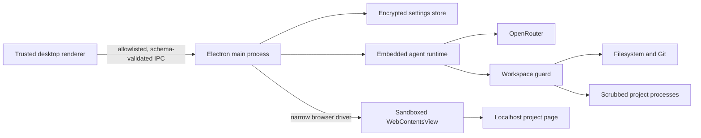
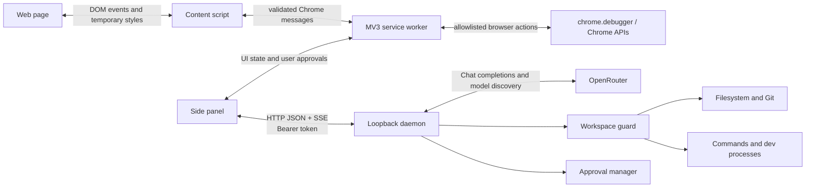

# Architecture

## Primary desktop architecture

The installable desktop edition embeds the agent runtime and owns an isolated localhost browser. It removes the end-user HTTP, port, daemon, token, `.env`, and unpacked-extension setup surfaces.

The trusted renderer handles user intent and approvals but never receives the saved provider key. `contextIsolation` and Chromium sandboxing remain enabled, Node integration is disabled, window creation and permissions are denied, and main-frame navigation is limited to loopback HTTP(S). The browser driver exposes a finite vocabulary instead of generic IPC or arbitrary host execution.

The main process constructs the same guarded project, approval, model, and tool-loop services used by the legacy daemon, without loading a repository `.env` or opening a network port. Non-secret settings and recent projects live below Electron's per-user application data directory. The provider key is encrypted with Electron `safeStorage`; environments without a secure backend are rejected instead of falling back to plaintext.

Project development processes, Git commands, and agent shell tools receive a sanitized environment. `OPENROUTER_API_KEY` and `BROWSER_AGENT_TOKEN` are removed even when the optional legacy daemon was started from `.env`.

### Optional codebase-map subsystem

The default-off codebase map is rooted in `apps/daemon/src/codebase-map/`, with its complete settings surface under `apps/desktop/src/renderer/src/codebase-map/`. When disabled, it contributes no model tool definition. When enabled, the runtime lazily parses supported files within the selected workspace, keeps its versioned cache below local app data, and exposes one bounded `codebase_map` query tool. Each agent run snapshots the toggle state so its tool list remains consistent for that run.

The subsystem is read-only with respect to the selected project. Its graph carries source ranges, evidence classes, confidence, unresolved targets, freshness, and truncation metadata; callers must use these as navigation hints and verify current source. See [Optional codebase map](CODEBASE_MAP.md) for actions, privacy behavior, limits, and exact removal seams.

## Legacy Chrome architecture

The extension/loopback design below remains as an optional compatibility mode for controlling an existing Chrome profile.

## System shape

The product is split at the browser/host trust boundary. The extension owns browser interaction; the local daemon owns secrets and operating-system interaction. The model has neither authority directly.

## Responsibilities

### Side panel

- Presents connection settings, model selection, project state, bounded local conversation history, chat, approvals, selected elements, and visual changes.
- Builds agent context from explicit user selection rather than automatically copying the entire page.
- Streams agent events from the daemon and sends browser requests to the background service worker.
- Must recover its state after being closed or after a service-worker restart.

Chrome side-panel pages are extension pages with access to Chrome APIs. The manifest declares `"sidePanel"` and a local `side_panel.default_path`; see the [Side Panel API](https://developer.chrome.com/docs/extensions/reference/api/sidePanel).

### Background service worker

- Applies the Chrome authority boundary: validates messages, identifies the active tab, allowlists browser operations, and owns debugger attachment.
- Opens or enables the side panel in response to user gestures and tab changes.
- Brokers commands to the top-frame content script.
- Cleans up debugger sessions when a tab closes or Chrome reports detachment.

It cannot use the DOM or `window`, and it can be terminated after inactivity. Event listeners must be registered synchronously at module top level and durable state must live in storage or another process. See [extension service workers](https://developer.chrome.com/docs/extensions/develop/concepts/service-workers) and their [lifecycle](https://developer.chrome.com/docs/extensions/develop/concepts/service-workers/lifecycle).

### Content script

- Draws picker hover/selection overlays and captures compact element context.
- Generates stable selector candidates and labels, while treating navigation as invalidating prior element IDs.
- Applies temporary CSS preview overrides.
- Maintains bounded undo/redo history and can discard all previews.

Content scripts run in an isolated JavaScript world. They can see the page DOM but not page JavaScript variables, and they receive only a limited set of Chrome APIs. See [content scripts](https://developer.chrome.com/docs/extensions/develop/concepts/content-scripts).

### Local daemon

- Loads private environment configuration and binds to `127.0.0.1`.
- Authenticates privileged routes with a bearer token and validates request bodies.
- Discovers OpenRouter models and runs a bounded tool-calling loop.
- Selects one workspace and applies canonical path containment to every filesystem or command operation.
- Controls a single project development process and retains bounded logs.
- Emits structured Server-Sent Events for model output, tools, approvals, browser requests, completion, cancellation, and failure.

### Shared protocol

`packages/shared` is the contract. Zod schemas constrain project records, element context, visual deltas, browser actions, agent requests, tool arguments, approvals, logs, and events. Both sides should parse data at ingress rather than relying on TypeScript types at runtime.

## Main flows

### Element selection

1. The user starts the picker in the side panel.
2. The service worker sends an allowlisted `picker.start` command to the active tab.
3. The content script highlights the pointer target without modifying source files.
4. A click captures a compact locator, bounds, styles, snippet, and readable label.
5. The content event returns through the service worker for display and optional inclusion in the next agent request.

Selection is best-effort browser state. Navigation, DOM replacement, responsive changes, and frame changes can make a locator stale.

### Reversible visual preview

1. The user selects one or more elements.
2. A property/value change is sent to the content script.
3. The preview editor records the previous inline value and applies a temporary override.
4. Undo/redo traverses the bounded history; discard restores all recorded inline state.
5. Converting that preview into a source patch is a separate, approval-gated agent operation and is not guaranteed by DOM selection alone.

### Agent run

1. The side panel sends a schema-validated run request containing messages, model ID, project root, active-tab metadata, selected elements, and visual deltas.
2. The daemon opens an SSE response and asks OpenRouter for a non-streaming tool decision.
3. If the model returns tool calls, the daemon parses their JSON arguments against the named tool schema.
4. Read-only workspace tools may run immediately. Writes, commands, and browser side effects pass through the approval manager according to the selected mode.
5. Browser tools emit a `browser.request`; the extension executes the allowlisted operation and posts a matching result back.
6. The daemon appends the assistant tool calls and matching tool results, then calls OpenRouter again with the complete tool list.
7. The bounded loop emits completion, cancellation, or a structured failure.

OpenRouter follows the OpenAI-style tool-call exchange. The complete `tools` array should be included on each request, and each `tool` message must carry the matching tool-call ID. See [OpenRouter tool calling](https://openrouter.ai/docs/guides/features/tool-calling).

## Transport and API conventions

- Daemon base URL: `http://127.0.0.1:3210` in the example configuration.
- Ordinary operations use JSON over HTTP.
- Agent runs use Server-Sent Events to deliver ordered typed events.
- Privileged calls use `Authorization: Bearer <BROWSER_AGENT_TOKEN>`.
- `/health` may be unauthenticated for local reachability; it must reveal no secrets or sensitive state.
- Browser results and approval decisions are correlated by generated IDs.
- Error bodies should use the shared `{ error: { code, message, issues? } }` envelope.

The extension's cross-origin daemon fetch originates from a trusted extension page and requires loopback host permissions. Content scripts must not call the daemon directly; Chrome applies page-origin rules to their requests. See [cross-origin network requests](https://developer.chrome.com/docs/extensions/develop/concepts/network-requests).

## State and recovery

- Selected/recent project metadata is persisted by the daemon; process handles and active runs are not restart-safe.
- Extension settings are persisted in `chrome.storage.local`, restricted to trusted extension contexts.
- Picker selections and temporary edits belong to a particular document lifetime and should be cleared on navigation.
- The service worker must tolerate recreation at any time and reattach only after explicit need.
- SSE disconnection should be surfaced as interruption, not mistaken for successful completion.

## Why the MVP uses HTTP + SSE

Loopback HTTP is easy to inspect, test, and integrate with a Vite extension. Bearer authentication, strict origin handling, schema validation, and fixed loopback binding are mandatory compensating controls. Native Messaging could give Chrome a more explicit host boundary and extension-ID allowlist, but adds packaging and installation complexity; it is deferred rather than implied to exist.

## Design invariants

1. The OpenRouter key never crosses into the extension or page.
2. Every host path is re-resolved inside one selected workspace.
3. Model output never becomes executable extension code.
4. Browser and host mutations are narrow, visible, and approval-aware.
5. A visual preview is not represented as a persisted code change.
6. Event, result, and log sizes are bounded.
7. Feature status is documented honestly; unsupported frames, pages, and workflows fail visibly.
8. The optional codebase map is never treated as source authority and is absent from new agent runs while disabled.
